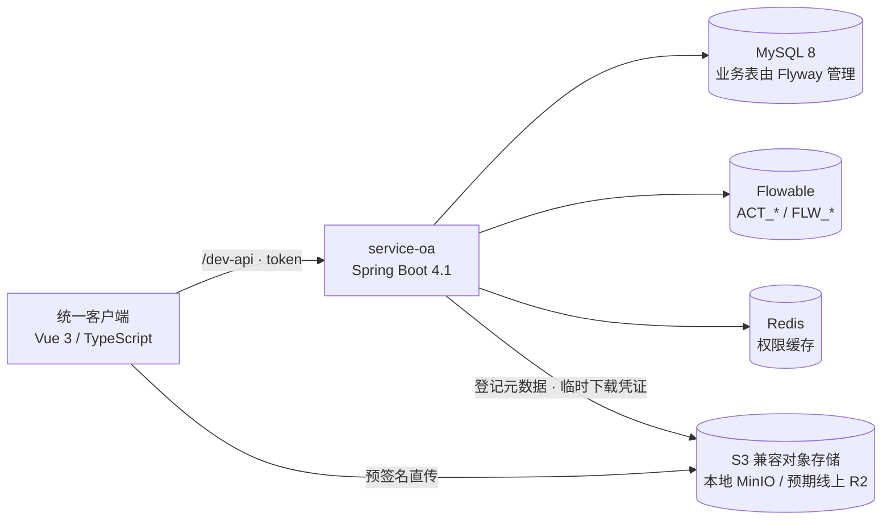
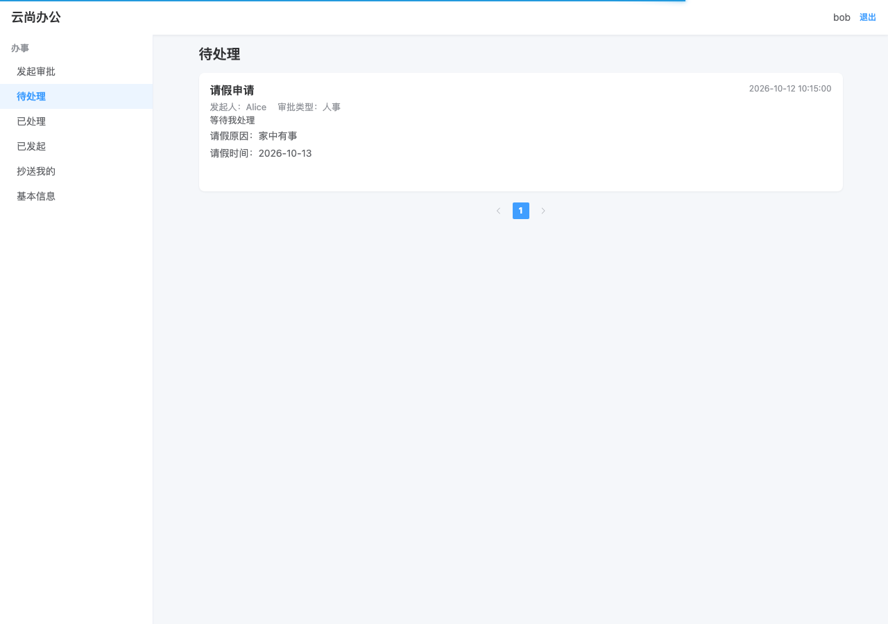
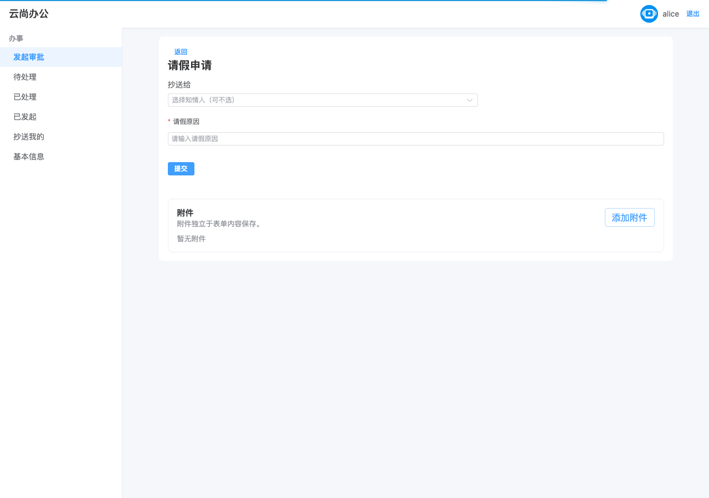
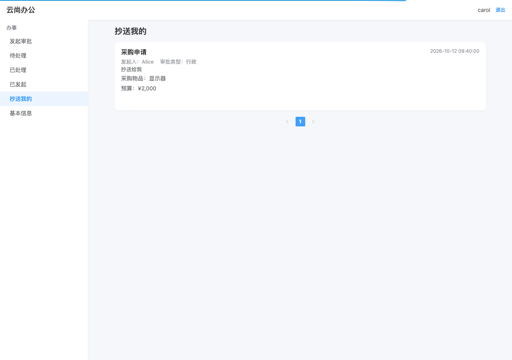
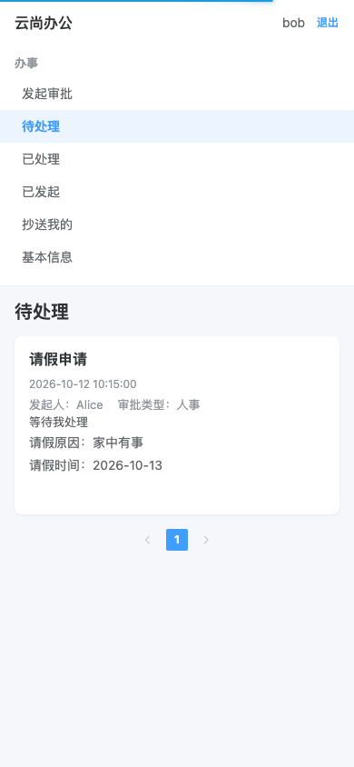

# 云尚办公

[](https://github.com/lautung/guigu-oa/actions/workflows/ci.yml)

**一句话：** 把尚硅谷《云尚办公》课程项目迁成可演示的全栈作品：Spring Boot 4.1、JDK 21、Flowable 8 和 Vue 3 统一客户端，并补上原创的**抄送**与**审批附件直传**。

| 看什么       | 去哪                                                                                  |
| ------------ | ------------------------------------------------------------------------------------- |
| 在线演示     | 公网 demo 暂未部署；请用下方 Compose 本地启动                                         |
| 本地一键启动 | `docker compose up --build`，详见[Compose 演示说明](docs/development/compose-demo.md) |
| 领域与边界   | [GLOSSARY.md](GLOSSARY.md)                                                              |

## 项目起点与改造

项目从尚硅谷公开课《云尚办公》起步。课程项目使用 Activiti 7、Spring Boot 2 和 JDK 8，提供 PC 管理端与公众号员工 H5。本仓库已将旧前端退役，源码保存在 `legacy-frontends` annotated tag 中。

改造重点是迁移与工程化：保留 OA 工作流场景，将后端升级到 JDK 21、Spring Boot 4.1 和 Flowable 8；把办事与配置合并到一个 Vue 3 客户端；用 Flyway、BCrypt、CI、Compose 和合同测试把运行与交付过程明确下来。原创部分是抄送与审批附件直传，并非从零编写工作流引擎或整套 OA。

| 维度     | 课程起点                  | 本仓库                                |
| -------- | ------------------------- | ------------------------------------- |
| 运行时   | JDK 8、Spring Boot 2.x    | **JDK 21、Spring Boot 4.1**           |
| 流程引擎 | Activiti 7                | **Flowable 8.0 Process**              |
| 前端     | PC 管理端 + 公众号员工 H5 | **Vue 3.5 统一客户端**                |
| 表单     | form-create 2.x           | **form-create 3.x**                   |
| 工程     | 手动 SQL、旧密码方案      | **Flyway、BCrypt、GitHub Actions CI** |
| 演示     | 无一键演示环境            | **Compose + MinIO + 演示数据**        |

旧两端的页面与能力对照见[研究文档](docs/research/现有两端能力与路由对照.md)。

## 架构



办事与配置共用一个客户端，侧栏按权限显示。流程定义通过 zip 上传并保存到可配置的外部目录；流程文件不进入附件桶。

## 原创模块

### 抄送

- 审批中增加「抄送我的」列表；抄送人获得知情访问，不进入待处理队列。
- 发起时和任务到达时按规则生成抄送；规则保存在业务表，不写进 BPMN。
- `TASK_CREATED` 监听器与引擎事务协同，`task_id` 提供幂等边界。
- 抄送人可查看表单、流转记录和附件，但不能审批、评论或继续抄送。

### 审批附件直传

- 附件挂在审批实例上，独立于动态表单；权威记录保存在附件元数据表。
- 浏览器通过预签名 URL 直传到私有 S3 兼容桶；发起后不可删除。
- 下载前按审批成员身份校验权限，覆盖发起人、审批人和抄送人。
- 本地 Compose 使用 MinIO；线上 R2 尚未部署。

## 界面截图

以下图片展示统一客户端的页面布局。它们由 Playwright 客户端测试使用接口夹具采集，用于展示界面，不代表后端或公网 demo 已运行。需要体验真实全栈流程时，请按 [Compose 演示说明](docs/development/compose-demo.md)启动环境。

### Bob 的待处理列表



### Alice 发起审批与附件区



### Carol 的抄送列表



### 手机视口办理审批



## 工程化

- 后端合同测试覆盖 API、Flowable 和持久层边界；前端使用 Vitest 与 Playwright 冒烟检查。
- CI 检查前端 lint、类型、单测和 Playwright，运行 Maven 测试，并构建前后端容器镜像；不自动部署。覆盖率报告写入 Actions summary 并上传 artifact，不卡红。
- 统一客户端使用 TypeScript、ESLint 和 Prettier；业务表由 Flyway 管理，Flowable 引擎表由引擎创建。

## 快速开始

安装 Docker Compose 后，在仓库根目录运行：

```bash
docker compose up --build
```

浏览器打开 <http://localhost:9530>。本地演示账号的密码均为 `111111`：

| 用户名  | 用途           |
| ------- | -------------- |
| `admin` | 配置与办事     |
| `alice` | 发起审批       |
| `bob`   | 查看并处理待办 |
| `carol` | 查看抄送       |

演示数据包含 Bob 的待处理和已结束审批、Carol 的抄送记录，以及一条带附件元数据和文件的审批。重置 Compose 演示数据会删除该项目的 MySQL、Redis、MinIO 和流程定义卷，再由 Flyway、Flowable 与演示初始化器重新生成：

```bash
docker compose down --volumes --remove-orphans
docker compose up --build
```

## 本地开发

后端需要 JDK 21。启动方式、数据库配置和 API 地址见仓库 [AGENTS.md](AGENTS.md)：

```bash
cd server/guigu-oa-parent/service-oa
mvn -DskipTests install
java -jar target/service-oa.jar
```

启动统一客户端：

```bash
cd client/guigu-oa-client
npm install
npm run dev
```

客户端开发代理将 `/dev-api` 转发到 `http://localhost:8800`。质量检查命令：

```bash
npm run lint
npm run typecheck
npm run test:unit
npm run test:e2e
npm run build:prod
```

### 测试与覆盖率

覆盖率是**可报告、不卡红**的指标（见[面试作品化改造规格](docs/spec/面试作品化改造规格.md)）：不设阈值，不影响构建结果，只写进 CI 的 job summary 并上传 HTML artifact。当前基线：客户端行 91.3% / 分支 83.6%，服务端行 93.4% / 分支 81.8%。

```bash
# 客户端：Vitest 覆盖率，报告在 coverage/
npm run coverage

# 服务端：JaCoCo 聚合报告，报告在 coverage-report/target/site/jacoco-aggregate/
mvn -f server/guigu-oa-parent/pom.xml test

# 两端一起跑并打印汇总
./scripts/coverage.sh
```

口径与排除项：

- 客户端统计全量 `src/**/*.{ts,vue}`，只排除没有运行时语义的 `src/main.ts`、`src/env.d.ts` 和 `src/types/**`；`src/api/**` 留在分母内。
- 服务端聚合 `service-oa`、`common-util`、`service-util` 和 `spring-security`，排除 Lombok 数据类 `com.atguigu.model.*` 与演示数据播种 `com.atguigu.demo.*`。
- 指标以行和分支为准；方法/类覆盖只在 HTML 明细里参考。
- `src/views/**` 用挂载测试覆盖主要交互；`npm run test:e2e` 的 Playwright 用例仍负责整链路行为，两者的覆盖不合并统计。

五类测试（功能、接口、性能、安全、兼容性）的方案、执行记录与证据见 [docs/test/](docs/test/)：总方案在 [plan.md](docs/test/plan.md)，用例与阈值在 [plan/](docs/test/plan/)，每轮结果在 [execution/](docs/test/execution/)，总体结论与缺陷汇总在 [report.md](docs/test/report.md)。

## 文档

- [Compose 演示与种子数据](docs/development/compose-demo.md)
- [面试作品化改造规格](docs/spec/面试作品化改造规格.md)
- [领域词汇](GLOSSARY.md)
- [两端能力与路由对照](docs/research/现有两端能力与路由对照.md)
- [可观测性](docs/observability.md)
