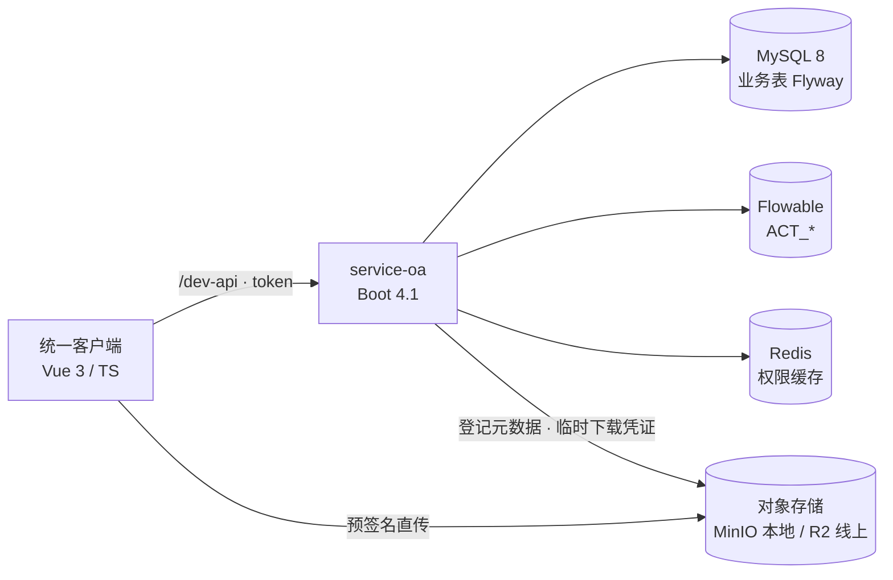

<!--
  PROTOTYPE — 对应 wayfinder 票：README 首屏与项目叙事长什么样
  用途：让人在 30 秒内判断叙事是否成立；不覆盖仓库根 README.md（执行阶段再换）。
  路径按已定清理票使用 client/ / server/（尚未执行改名时请脑补）。
-->

# 云尚办公

[](https://github.com/lautung/guigu-oa/actions/workflows/ci.yml)

**一句话：** 把尚硅谷《云尚办公》课程项目，迁成可演示的全栈作品——Spring Boot 4.1 / JDK 21 / Flowable 8 + Vue 3 统一客户端，并原创 **抄送** 与 **附件直传** 两块。

| 看什么 | 去哪 |
| --- | --- |
| 在线演示 | _（执行后填 Oracle 地址）_ · 账号见下方 |
| 本地一键起 | `docker compose up`（见 [快速开始](#快速开始)） |
| 领域词汇 | [GLOSSARY.md](../../GLOSSARY.md) |

---

## 这是什么 / 我做了什么

起点是尚硅谷公开课《云尚办公》（Activiti 7、Boot 2 时代、PC 管理端 + 公众号员工 H5）。
**我没有假装从零手写整个 OA**；作品证明的是：能把遗留系统迁到当代栈、用测试钉住行为，再补上课程没有的、经得起追问的设计。

| 我做的 | 不是我吹的 |
| --- | --- |
| 引擎 Activiti 7 → Flowable 8；Boot → 4.1；JDK → 21 | 「独立发明了一套工作流引擎」 |
| 双前端 → 一个统一客户端（办事 + 配置） | 「从零画了全部业务页面」 |
| 原创：抄送、附件预签名直传；修掉流程 zip 写 classpath 的硬伤 | 「市面独有的 OA」 |
| 合同测试 + CI + compose 演示 | 「日活百万的生产系统」 |

---

## 迁移对照

| 维度 | 课程起点 | 本仓库 |
| --- | --- | --- |
| 运行时 | JDK 8 · Spring Boot 2.x | **JDK 21 · Spring Boot 4.1** |
| 流程引擎 | Activiti 7 | **Flowable 8.0 Process** |
| 前端 | 管理端 + 员工 H5（已删，见 tag `legacy-frontends`） | **Vue 3.5 · Vite 8 · 统一客户端** |
| 表单 | form-create 2.x | **form-create 3.x + designer 3.5** |
| 工程 | 无 CI、手跑 SQL、明文 MD5 | **GitHub Actions · Flyway · BCrypt · 短 JWT** |
| 演示 | 无 | **compose 一键起 · 截图 · 线上 demo** |

更细的路由/能力对照：[docs/research/现有两端能力与路由对照.md](../research/现有两端能力与路由对照.md)

---

## 架构（面试够用的粒度）



配置与办事同一套客户端；侧栏按权限出菜单。流程定义用 **zip 上传**（可配置外部目录），不做在线 BPMN 设计器。

---

## 原创模块（深挖入口）

### 抄送

- 办事组第四种列表「抄送我的」；知情授权，不进待处理。
- 发起时 + 节点到达时产生；规则在业务表，**不写进 BPMN**。
- 全局监听 `TASK_CREATED`，与引擎同事务；`task_id` 幂等。
- 完整可见（表单 / 流转 / 附件），不能评论、不能再抄；无已读状态。

### 附件直传

- 挂在审批实例上；独立附件区，权威在元数据表。
- 预签名上传 → 私有桶 → 短时下载凭证；发起后不可删。
- 下载前做审批成员水平鉴权（发起人 / 审批人 / 抄送人）。

---

## 界面（占位——执行阶段换成真图）

建议 4 张，放 `docs/images/`（或 README 同级 `images/`）：

1. **待处理列表**（桌面）
2. **发起审批 + 附件区**（桌面）
3. **抄送我的**
4. **手机 viewport 办事**（同一条主路径）

_（此处截图 / 15s GIF；无图时面试官仍可读上表与 compose）_

---

## 工程化信号

- 后端合同测试（H2 + MockMvc + Flowable 内存引擎）· 前端 Vitest · Playwright 冒烟（含 mobile viewport）
- CI：`lint` + `vue-tsc` + 单测 + e2e 冒烟 + `mvn test` + 镜像 build（不自动部署）
- 全量 TypeScript（strict）· ESLint flat + Prettier · Flyway（仅业务表）

---

## 快速开始

```bash
docker compose up
# 浏览器打开提示的地址（默认前端 9530 或 Caddy 入口）
```

演示账号（口令见 compose / `.env.example`，库内 BCrypt）：

| 用户 | 用途 |
| --- | --- |
| `admin` | 配置 |
| `alice` | 发起 |
| `bob` | 审批（种子里有待处理） |
| `carol` | 抄送 |

不用 compose 时：后端 `server/guigu-oa-parent`，前端 `client/guigu-oa-client`（详见 `AGENTS.md`）。

---

## 文档

| 文档 | 内容 |
| --- | --- |
| [GLOSSARY.md](../../GLOSSARY.md) | 领域词汇 |
| [docs/spec/](../spec/) | 改造规格 |
| [docs/research/](../research/) | 选型与引擎调研 |
| tag `legacy-frontends` | 删除旧前端前的快照 |

---

## 语言

正文 **中文**（面向国内全栈面试阅读）。技术专名保留英文（Flowable、Flyway、Playwright 等）。不维护平行英文全文。
